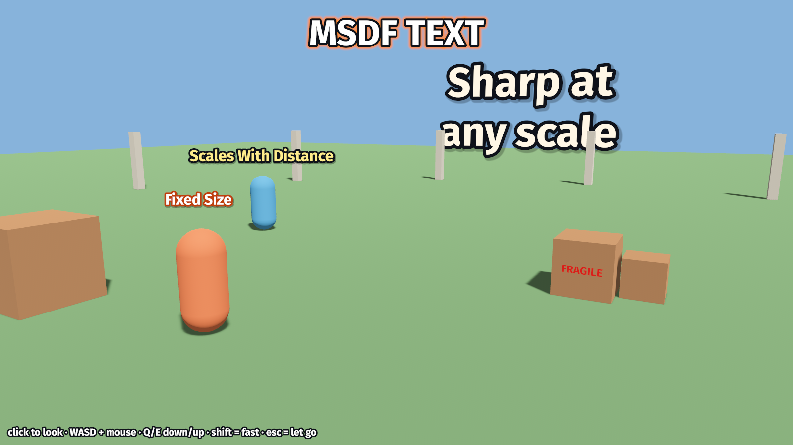

# bevy_msdf_text

Crisp text for Bevy 0.19 from a multi-channel signed distance field (MTSDF)
glyph atlas. One atlas, generated at load time in pure Rust, serves every
size. Outlines, glows and drop shadows are a few shader ops per pixel. Text can
be a billboard in the world, a name tag with a fixed pixel size, a flat sign, or
HUD text.



*The `nametags` example (`cargo run --example nametags`).*

Bevy's built-in text rasterizes bitmap glyphs on the CPU, one atlas per font
size, and has no stroke. Scaling it blurs it, and an outline means stacking
copies. An SDF stores *distance to the outline* instead of coverage, so the
shader can cut a sharp edge at any magnification and draw an outline anywhere
along the distance range.

## Usage

```rust,no_run
use bevy::prelude::*;
use bevy_msdf_text::*;

fn main() {
    App::new()
        .add_plugins((DefaultPlugins, MsdfTextPlugin))
        .add_systems(Startup, setup)
        .run();
}

fn setup(mut commands: Commands, assets: Res<AssetServer>) {
    commands.spawn(Camera3d::default());
    // Typed load: `.ttf` / `.otf` through the MSDF loader, not Bevy's `Font`.
    let font: Handle<MsdfFont> = assets.load("fonts/FiraSans-Bold.ttf");

    // A name tag: follows its parent, always 28 px tall on screen.
    commands.spawn((
        MsdfText::new("Player One", font.clone())
            .with_mode(MsdfTextMode::WorldFixedPx)
            .with_size(28.0)
            .with_outline(0.12, Color::BLACK)
            .with_shadow(MsdfShadow::drop(Color::srgba(0.0, 0.0, 0.0, 0.5), Vec2::new(0.04, -0.06), 0.05))
            .with_anchor(Vec2::new(0.0, -0.5)), // bottom-center sits on the point
        Transform::from_xyz(0.0, 2.2, 0.0),
    ));

    // HUD text, 16 px from the bottom-left corner.
    commands.spawn(
        MsdfText::new("hello", font)
            .with_mode(MsdfTextMode::Screen { at: Vec2::new(0.0, 1.0), offset: Vec2::new(16.0, -16.0) })
            .with_size(24.0)
            .with_anchor(Vec2::new(-0.5, -0.5))
            .with_align(TextAlign::Left),
    );
}
```

### `MsdfText`

| field | meaning |
|---|---|
| `text` | `\n` breaks lines |
| `font` | `Handle<MsdfFont>` |
| `mode` | see below |
| `size` | world units per em (`World`, `Plane`) or logical pixels per em (`WorldFixedPx`, `Screen`) |
| `color` | fill |
| `outline_width`, `outline_color` | em |
| `shadow: Option<MsdfShadow>` | `MsdfShadow::drop(color, offset, softness)` or `::glow(color, softness)`, em |
| `anchor` | which point of the text block sits on the entity: `(0, 0)` center, `(-0.5, -0.5)` bottom-left |
| `align` | `Left` / `Center` / `Right` per line |
| `line_height`, `letter_spacing` | multiplier, em |

Lengths are in em, so a style looks the same at every size. Effects can reach
`range_em / 2` outside the glyph outline (0.25 em with the default atlas). Keep
`outline_width + softness + |offset|` below that, or raise `range_px`.

### `MsdfTextMode`

| mode | placement |
|---|---|
| `World` | billboard at the entity, faces the camera, shrinks with distance |
| `WorldFixedPx` | anchored to the entity, constant pixel size: game name tags |
| `Screen { at, offset }` | HUD: `at` is a viewport point (0..1, top-left origin), `offset` pixels from it; drawn on top |
| `Plane` | flat in the entity's local XY plane, oriented by its transform: a sign on a wall |

The mesh is only rebuilt when the `MsdfText` changes, when its font
(re)loads, or when the window's scale factor changes.

### Atlas settings

```rust,ignore
let font: Handle<MsdfFont> = assets
    .load_builder()
    .with_settings(|s: &mut MsdfAtlasSettings| {
        s.charset = format!("{ASCII}·äöü"); // default: printable ASCII
        s.em_px = 48.0;                     // atlas texels per em
        s.range_px = 24.0;                  // distance range, texels
    })
    .load("fonts/MyFont.ttf");
```

## How it works

**Atlas (load time, `src/atlas.rs`).** For each character the glyph outline
comes from `ttf-parser`. [`fdsm`](https://gitlab.com/Kyarei/fdsm) colors its
edges and generates an MTSDF: three channels of per-edge-color pseudo-distance
(their median reconstructs sharp corners, which a single SDF rounds off) plus a
true Euclidean SDF in alpha. Error correction and sign correction follow, as in
msdfgen. Cells are shelf-packed into one linear `Rgba8Unorm` texture (never
sRGB: the channels are distances, not colors). Advances, padded plane bounds,
ascender/descender and GPOS (or legacy `kern`) pair kerning are stored in em.
Printable ASCII at 48 px/em takes about 0.2 s natively and 0.4 s in wasm,
single-threaded, once per font.

**Layout (`src/layout.rs`).** One mesh per text: a quad per glyph in em units
around the anchor. `position.z` carries a layer (0 fill, 1 outline, 2 shadow).
Each enabled layer is a full pass over the glyphs, emitted back to front.
Triangles within a draw are blended in order, so a glyph's outline never covers
its neighbour's fill, and nothing needs sorting.

**Shader (`src/msdf_text.wgsl`, one `Material`, unlit, premultiplied alpha).**

- *Vertex:* the anchor is the entity's world position. `World` offsets it
  along the camera's right/up vectors in world units. `WorldFixedPx` projects
  the anchor, then offsets in clip space by `px * 2 / viewport * w`, so the
  perspective divide keeps the size constant. `Screen` skips the projection
  and puts the text at the near plane. `Plane` is an ordinary model transform.
  All four share one pipeline.
- *Fragment:* msdfgen's `screenPxRange`:
  `0.5 * dot(pxRange / atlasSize, 1 / fwidth(uv))` is how many screen pixels
  the distance range spans at this pixel. It is derived from the uv
  derivatives, so it holds under any scale, tilt or perspective. Then
  `median(r, g, b)` gives the sharp fill edge, antialiased over one screen
  pixel. The outline and shadow use the alpha channel's true SDF, offset by
  the outline width: rounded joins, and correct far from the glyph where the
  MSDF median is not. The shadow fades out over `softness` with a
  `smoothstep`, and a glow is a shadow without an offset.

## Examples

- `cargo run --example nametags`: two wanderers with a `WorldFixedPx` and a
  `World` name tag, a giant `Plane` sign to fly up to, and outlined HUD text.
  Click to look (pointer lock), WASD + Q/E to move, shift = fast, Esc lets go.
- `cargo run --example outline`: plain / outline / thick / glow / shadow at
  12 to 64 px.

Web (WebGPU): `web/index.html` loads `nametags.js` (wasm-bindgen
`--target web`), with `assets/` copied next to it.

## Credits and references

- Viktor Chlumský, *Shape Decomposition for Multi-channel Distance Fields*
  (2015) and [msdfgen](https://github.com/Chlumsky/msdfgen) /
  [msdf-atlas-gen](https://github.com/Chlumsky/msdf-atlas-gen) (MIT): MSDF,
  MTSDF and the `screenPxRange` shader.
- [fdsm](https://gitlab.com/Kyarei/fdsm) by +merlan #flirora (MIT): the
  pure-Rust generator used here.
- Chris Green, *Improved Alpha-Tested Magnification for Vector Textures and
  Special Effects* (Valve, SIGGRAPH 2007): SDF text with outlines and glows.
- [troika-three-text](https://github.com/protectwise/troika) (MIT) and
  [bevy_mod_billboard](https://github.com/kulkalkul/bevy_mod_billboard):
  ideas for outlines and billboarding. No code was copied.
- Font: [Fira Sans](https://github.com/mozilla/Fira) Bold, SIL Open Font
  License 1.1 (`assets/fonts/FiraSans-OFL.txt`).

## License

MIT OR Apache-2.0 (`LICENSE-MIT`, `LICENSE-APACHE`). The bundled font is OFL-1.1.
